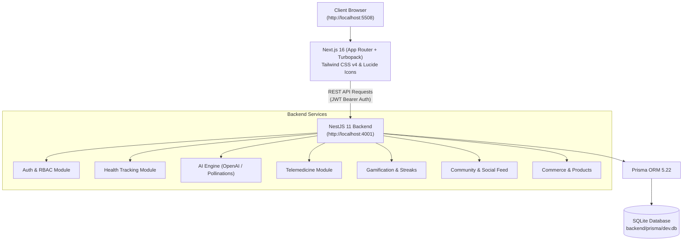

# 🏥 HealthCare - AI-Powered Health & Wellness Ecosystem

<p align="center">
  
  
  
  
  
  
  
</p>

An intelligent, full-stack healthcare and lifestyle optimization platform that brings together personalized health tracking, smart AI nutrition consulting, telemedicine appointments, gamified wellness challenges, an e-commerce health store, and an active community network.

---

## 📑 Table of Contents

- [Overview](#-overview)
- [System Architecture](#-system-architecture)
- [Core Features](#-core-features)
- [Port Configuration](#-port-configuration)
- [Quick Start Guide](#-quick-start-guide)
- [Project Structure](#-project-structure)
- [API Reference](#-api-reference)
- [Environment Variables](#-environment-variables)
- [Troubleshooting & FAQ](#-troubleshooting--faq)

---

## 🌟 Overview

HealthCare delivers a unified health management experience:
- **Intelligent Diagnostics & Nutrition:** Real-time conversational AI coach for personalized diet recommendations, meal plans, and fitness guidance.
- **Holistic Health Tracking:** Track meals, macros, water intake, sleep patterns, and physical workouts in one place.
- **Telemedicine & Professional Consultations:** Discover certified cardiologists, neurologists, surgeons, and dietitians with direct appointment scheduling.
- **Gamification & Rewards:** Earn XP, level up, maintain streaks, complete fitness challenges, and redeem coins for health rewards.
- **E-Commerce Health Store:** Purchase vitamins, supplements, and wellness essentials.
- **Social Community:** Share milestones, engage with fellow fitness enthusiasts, and receive automated coach encouragement.

---

## 🏛 System Architecture



---

## 🚀 Port Configuration

| Service | Port | Local URL | Description |
| :--- | :--- | :--- | :--- |
| **Frontend Web App** | **`5508`** | [http://localhost:5508](http://localhost:5508) | Next.js 16 client application |
| **Backend REST API** | **`4001`** | [http://localhost:4001](http://localhost:4001) | NestJS modular API server |
| **Database** | Embedded | `backend/prisma/dev.db` | Pre-configured SQLite database |

---

## ✨ Core Features

### 1. 📊 Holistic Health Dashboard (`/`)
- Unified visual cockpit displaying daily calories, hydration progress, sleep score, and active workout stats.
- Progress radial bars and interactive trend charts.
- Quick logging shortcuts for rapid data entry.

### 2. 🥗 Meal & Macronutrient Tracking (`/meals`)
- Log meals (Breakfast, Lunch, Dinner, Snack) with calorie and macronutrient breakdown (Proteins, Carbs, Fats).
- Daily target tracking with remaining allowance calculation.

### 3. 💧 Water Intake & Hydration Tracker (`/water`)
- Quick-add increments (+250ml, +500ml) towards a personalized daily hydration goal.
- Real-time hydration level percentage.

### 4. 🌙 Sleep Health Monitor (`/sleep`)
- Log sleep duration (hours/minutes) and subjective quality rating (1–10).
- Sleep schedule trends and consistency tracking.

### 5. 🏋️ Workout & Activity Logger (`/workouts`)
- Multi-discipline workout tracker (Strength, Cardio, HIIT, Running, Yoga, Swimming).
- Automatic calorie burn calculation and duration log.

### 6. 🤖 AI Nutritionist & Health Coach (`/ai-nutritionist`)
- Conversational assistant powered by **OpenAI GPT-4o-mini** with automatic high-availability fallback to **Pollinations.ai**.
- Provides customized meal ideas, caloric target guidance, and science-backed nutritional advice.

### 7. 🏆 Gamification, Challenges & Badges (`/challenges`)
- XP Progression system with dynamic player levels.
- Pre-seeded health challenges (e.g. *Hydration Master*, *7-Day Step Streak*).
- Achievement badges and redeemable coins.

### 8. 👨‍⚕️ Telemedicine Directory (`/directory`)
- Search verified medical professionals by specialty (Cardiology, Orthopedics, Neurology, Dietetics).
- View bio, credentials, years of experience, and book appointments directly.

### 9. 🛒 Store & Pro Memberships (`/store`)
- Browse curated health categories: **Subscriptions** (HealthCare Pro 1 Month & 1 Year plans), **Fitness Gear** (Smart Yoga Mat, Adjustable Dumbbells), and **Supplements** (Premium Whey Protein).
- Dedicated high-resolution product visuals, instant purchase workflow, discount coupon engine (`HEALTH20`), and comprehensive order history.

### 10. 💬 Community Social Network (`/community`)
- Share wellness achievements and fitness milestones.
- Like, comment, and receive friendly AI Coach feedback on posts.

---

## ⚡ Quick Start Guide

### Prerequisites
- **Node.js**: v18.0.0 or higher (v20+ recommended)
- **npm**: v9.0.0 or higher

### Installation

1. **Clone the repository:**
   ```bash
   git clone <repo-url>
   cd HealthCare
   ```

2. **Install all dependencies:**
   ```bash
   # Install root dependencies
   npm install

   # Install backend dependencies
   npm install --prefix backend

   # Install frontend dependencies
   npm install --prefix frontend
   ```

3. **Database Setup & Complete Data Seeding:**
   ```bash
   # Seed complete production-grade data (Users, Doctors, Store, Challenges, Community Feed)
   node backend/seed_complete_data.js
   ```

### 👤 Demo Accounts

| Role | Email | Password | Details |
| :--- | :--- | :--- | :--- |
| **Demo User** | `demo@healthcare.ai` | `Health1234!` | Full health records, meals, water, sleep, orders, appointments & challenges |
| **Secondary User** | `healthcheck@hv.ai` | `Health1234!` | Complete profile, community posts & activity |
| **Specialist Doctor** | `dr.priya@healthverse.ai` | `Doctor1234!` | Cardiologist specialist with appointments |
| **Clinical Dietitian** | `dt.kavya@healthverse.ai` | `Doctor1234!` | Certified clinical dietitian profile |

### 🏃 Running the Complete Application (Port 5508)

To launch both the **Backend API** and **Frontend Web App** concurrently with a single command:

```bash
npm run dev
```

- **Frontend App:** Visit **[http://localhost:5508](http://localhost:5508)** in your browser.
- **Backend API:** Available at **[http://localhost:4001](http://localhost:4001)**.

#### Running Services Separately (Optional)

- **Frontend only (Port 5508):**
  ```bash
  cd frontend
  npm run dev
  ```

- **Backend only (Port 4001):**
  ```bash
  cd backend
  npm run start:dev
  ```

---

## 📁 Project Structure

```text
HealthCare/
├── package.json              # Monorepo orchestration (runs both services)
├── docker-compose.yml        # Optional container configuration (Postgres/Redis)
├── README.md                 # Master project documentation
│
├── backend/                  # NestJS 11 REST API Application
│   ├── prisma/
│   │   ├── schema.prisma     # Database schema (SQLite dev.db)
│   │   └── dev.db            # Embedded SQLite database
│   ├── src/
│   │   ├── ai/               # AI Nutritionist & LLM Integration
│   │   ├── auth/             # JWT Authentication & RBAC Guards
│   │   ├── commerce/         # E-commerce store & orders
│   │   ├── community/        # Social feed, posts, comments
│   │   ├── gamification/     # XP, levels, challenges, badges
│   │   ├── health-tracking/  # Meals, water, sleep, workouts
│   │   ├── telemedicine/     # Doctors, dietitians, appointments
│   │   ├── users/            # User profile management
│   │   ├── main.ts           # Server bootstrap (Port 4001)
│   │   └── app.module.ts     # Main application module
│   ├── health_check.js       # End-to-end API verification script
│   └── package.json          # Backend dependencies & scripts
│
└── frontend/                 # Next.js 16 App Router Application
    ├── src/
    │   ├── app/
    │   │   ├── (auth)/       # Authentication pages (login, register)
    │   │   ├── (dashboard)/  # Main health app views & routes
    │   │   │   ├── meals/    # Meal tracking
    │   │   │   ├── water/    # Hydration tracking
    │   │   │   ├── sleep/    # Sleep tracking
    │   │   │   ├── workouts/ # Workout logs
    │   │   │   ├── ai-nutritionist/ # AI chat interface
    │   │   │   ├── challenges/      # Gamification
    │   │   │   ├── directory/       # Telemedicine doctors
    │   │   │   ├── store/           # E-commerce store
    │   │   │   └── community/       # Social feed
    │   │   ├── layout.tsx    # Root layout & theme provider
    │   │   └── globals.css   # Tailwind CSS v4 design tokens
    │   ├── components/ui/    # Accessible UI components (Shadcn)
    │   ├── context/          # React UserContext & Auth state
    │   └── lib/api.ts        # Unified API request client
    └── package.json          # Frontend scripts (Configured for Port 5508)
```

---

## 🔌 API Reference

### Authentication
- `POST /auth/register` — Register a new user account (`email`, `password`, `role`).
- `POST /auth/login` — Authenticate user and receive a signed JWT token.

### Health Tracking
- `GET /health/sync` — Retrieve today's consolidated health metrics.
- `POST /health/meal` — Log a meal (`name`, `calories`, `proteinG`, `carbsG`, `fatG`).
- `POST /health/water` — Log water intake (`amountMl`).
- `POST /health/sleep` — Log sleep record (`durationMin`, `quality`).
- `POST /health/workout` — Log workout activity (`type`, `durationMin`, `caloriesBurned`).

### AI Assistant
- `POST /ai/chat` — Send query to AI Nutritionist Coach (`{ "message": "..." }`).
- `POST /ai/meal-plan` — Generate customized daily meal plans.

### Telemedicine
- `GET /telemedicine/doctors` — Retrieve list of verified doctors and dietitians.
- `POST /telemedicine/book` — Schedule a consultation appointment.
- `GET /telemedicine/bookings` — View user's booked appointments.

### Gamification
- `GET /gamification/profile` — Get current XP, level, coin balance, and badges.
- `GET /gamification/challenges` — List active fitness challenges.

### Commerce
- `GET /commerce/products` — Retrieve store products catalogue.
- `POST /commerce/orders` — Submit product checkout order.

### Community
- `GET /community/posts` — Get recent community posts with comments & likes.
- `POST /community/posts` — Publish a fitness milestone or message.

---

## ⚙️ Environment Variables

### Backend (`backend/.env`)
```ini
PORT=4001
JWT_SECRET=supersecret_healthcare_jwt_key_2026
JWT_REFRESH_SECRET=supersecret_healthcare_refresh_key_2026

# Optional: Add OpenAI API key (falls back automatically to Pollinations.ai if omitted)
# OPENAI_API_KEY=sk-...
```

### Frontend (`frontend/.env.local` optional)
```ini
NEXT_PUBLIC_API_URL=http://localhost:4001
PORT=5508
```

---

## 🛠 Troubleshooting & FAQ

#### 1. Why port 5508?
The frontend development server has been configured to run on **Port 5508** (`next dev -p 5508`) to avoid common conflicts with standard ports (`3000`, `4000`, `8080`).

#### 2. How does the database work?
The project uses an embedded SQLite database located at `backend/prisma/dev.db`. No external PostgreSQL or Docker container is required to start running immediately.

#### 3. How to verify that the backend is responding?
Run the built-in health check script:
```bash
node backend/health_check.js
```

---

## 📄 License
This project is licensed under the MIT License. Feel free to use and customize it for your health tech innovations!

